# 19 — Diagrams: The Ads Business, Ads Serving ML, and Creative Intelligence

**Goal:** a picture for each important idea you need on Monday. Each one has a walkthrough of every box and arrow, plus a line you can say out loud. Read Parts A and B to stay fluent in ads. Spend most of your time on Part C, because that is the job.

**How to use this chapter**
- Diagrams are Mermaid. They render on GitHub and in most Markdown previewers (VS Code with a Mermaid extension, Obsidian, Typora). If they don't render, ASCII fallbacks for the three most important ones are in the **ASCII fallbacks** section near the end.
- Legend used throughout: **solid arrow** `-->` = synchronous request or data path. **Dotted arrow** `-.->` = asynchronous, delayed, or feedback path. **Thick arrow** `==>` = money, or the main path through the diagram.
- **Hedge:** these diagrams show a *typical retail media stack*. Walmart's internal architecture is not public. Public facts used here: Walmart Connect is Walmart's retail media network. Its products include Sponsored Products (Sponsored Search), Sponsored Brands, Sponsored Videos, on-site and off-site display through Walmart DSP (built with The Trade Desk), CTV through Vizio (acquired for about $2.3B), in-store screens, ads in the Sparky assistant, the Marty advertiser agent, and the Automated Creative Generator (reported about 80% faster creative production in beta). In 2025 it added Search incrementality reporting and received MRC accreditation for Sponsored Search click and impression metrics. In the interview, say "in a typical RMN stack..." or "I'd expect something like...". Don't say "Walmart does X."
- Consistent with [02_ads_ml_fundamentals.md](02_ads_ml_fundamentals.md) (auctions, autobidding, measurement) and [03_recsys_ranking_at_scale.md](03_recsys_ranking_at_scale.md) (funnel, ranking model, serving).

| # | Diagram | Part | Priority |
|---|---|---|---|
| 1 | Money flow and closed loop | A Business | Draw from memory |
| 2 | Three-sided tension | A Business | High |
| 3 | Ad product landscape and billing | A Business | Medium |
| 4 | Full funnel with metrics | A Business | Medium |
| 5 | Campaign lifecycle (state machine) | A Business | Medium |
| 6 | Search ad request, end to end (sequence) | B Serving ML | High |
| 7 | Multi-stage funnel, counts and latency | B Serving ML | Draw from memory |
| 8 | Ranking model architecture | B Serving ML | High |
| 9 | Auction and pricing | B Serving ML | High |
| 10 | Autobidding and pacing loop | B Serving ML | Medium |
| 11 | Training data flow | B Serving ML | High |
| 12 | Measurement and incrementality | B Serving ML | High |
| 13 | Where creative sits in the ads system | C Creative | Very high |
| 14 | Generative creative pipeline | C Creative | Draw from memory |
| 15 | Model-as-judge evaluation system | C Creative | Draw from memory |
| 16 | Creative understanding signal platform | C Creative | Very high |
| 17 | Video ad generation and adaptation | C Creative | High |
| 18 | Creative optimization loop | C Creative | Very high |
| 19 | Shared platform layering | C Creative | Very high |
| 20 | Sequenced roadmap | C Creative | High |

---

# Part A — The Business

## Diagram 1 — Money flow and the closed loop

Who pays whom, for what, and why retail media's reporting is different.

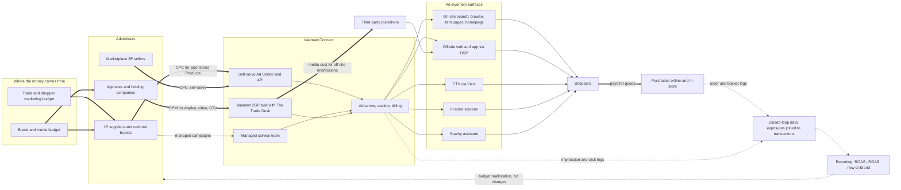

**How to read it**
- **Advertisers (left).** There are three kinds. *1P suppliers* sell to Walmart wholesale (P&G, PepsiCo) and are the biggest spenders. *3P marketplace sellers* list on walmart.com and are mostly self-serve, long-tail, and price-sensitive. *Agencies* buy on behalf of brands, mostly display and CTV.
- **Budget sources (top left).** Retail media is often funded from *trade and shopper marketing* budgets: money a brand already spends to win at the retailer. More and more it also draws from *brand and media* budgets that used to go to TV and social. That is why off-site display and CTV matter: they compete for the brand budget.
- **Thick arrows into Walmart Connect** are money. Sponsored Products is **CPC**: the advertiser pays only when a shopper clicks. Display, video, and CTV are mostly **CPM**: the advertiser pays per thousand impressions.
- **Inside Walmart Connect** there are three buying paths (self-serve, managed service, DSP). All of them land in the ad server, auction, and billing layer. That layer decides which ad shows on which surface.
- **Inventory surfaces** are every place an ad can appear: on-site pages, the open web through the DSP, CTV screens (Vizio), physical store screens, and the conversational assistant (Sparky).
- **Off-site impressions cost money.** For off-site, Walmart pays third-party publishers for the impression and earns a margin and data fee on top. On-site inventory is owned, so it is close to pure margin. This is why on-site search ads are the profit engine.
- **Shoppers pay for goods**, which is a separate revenue stream. Ads must not damage it. GMV is the guardrail.
- **The closed loop (dotted arrows).** Ad logs and purchase logs are joined. Walmart *observes* purchases, online and often in-store, through account, app, or payment linkage. It does not have to model them. That join powers reporting: ROAS, incremental ROAS, new-to-brand.
- **The loop back to advertisers.** Better measurement leads to more trust, which leads to budget moving from other channels into Walmart Connect. Measurement quality is a growth lever, not only a reporting feature.

**Say it in the interview:** "The money comes in as CPC on search and CPM on display and CTV, often from trade budgets first and then brand budgets. What makes retail media worth a premium is the closed loop: we see the exposure and the basket, so we can prove incremental sales. Better creative and better measurement both pull more budget onto the platform."

---

## Diagram 2 — The three-sided tension

Every design decision trades off three parties. Know the metrics each side cares about.

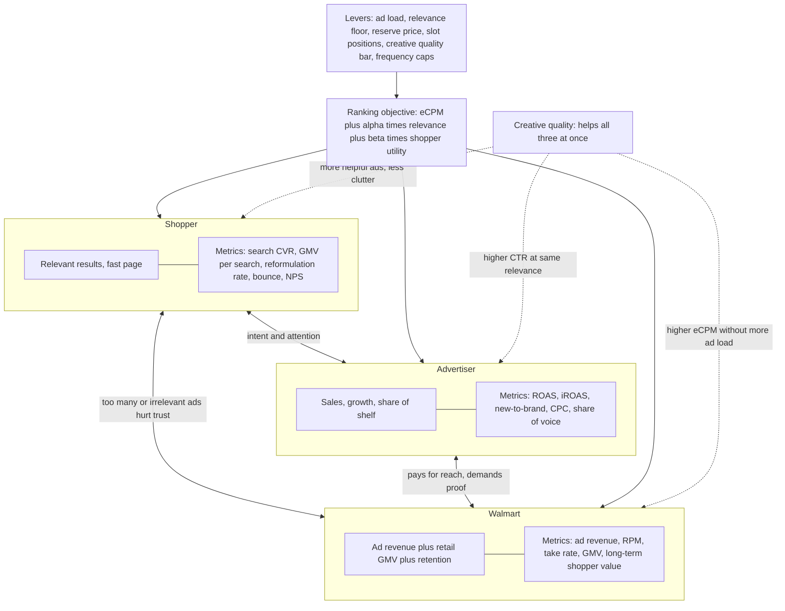

**How to read it**
- **Shopper box.** The shopper wants relevant results and a fast page. You measure the damage of bad ads through *organic* signals: search conversion rate, GMV per search, query reformulation (the shopper rewrites the query because results were bad), bounce.
- **Advertiser box.** Advertisers want sales and share of shelf. Sophisticated ones demand **iROAS** (incremental), not just attributed ROAS. Share of voice is how often their ads show for their category queries.
- **Walmart box.** Walmart wants ad revenue *and* retail GMV *and* long-term shopper value. Ad revenue that cuts GMV per search is a bad trade, because organic conversion is the asset being monetized.
- **Double-headed edges** are the tensions. Shopper vs. Walmart: ad load. Advertiser vs. Walmart: price and proof. Shopper vs. advertiser: attention. Advertisers want it, and shoppers give it only when the ad is relevant.
- **Levers box.** These are the knobs: ad load (how many slots), relevance floor (minimum relevance to show), reserve price, which slot positions are ads, frequency caps, and the creative quality bar.
- **Ranking objective.** The knobs come together in one blended score: eCPM plus weighted relevance plus weighted shopper utility. The alpha and beta weights are set by long-term experiments, not by a single A/B test on revenue.
- **Creative quality (dotted arrows) is the rare lever that helps all three.** A better creative raises CTR at the same relevance. The advertiser gets more clicks, the shopper sees a more helpful ad, and Walmart earns higher eCPM without adding ad slots. This is the business case for the role.

**Say it in the interview:** "Most ads levers move value between shopper, advertiser, and Walmart. Creative quality is one of the few that grows the pie for all three. A better creative gets more engagement at the same ad load and the same relevance, so I'd pitch creative intelligence as a GMV-safe revenue lever."

---

## Diagram 3 — Ad product landscape and billing models

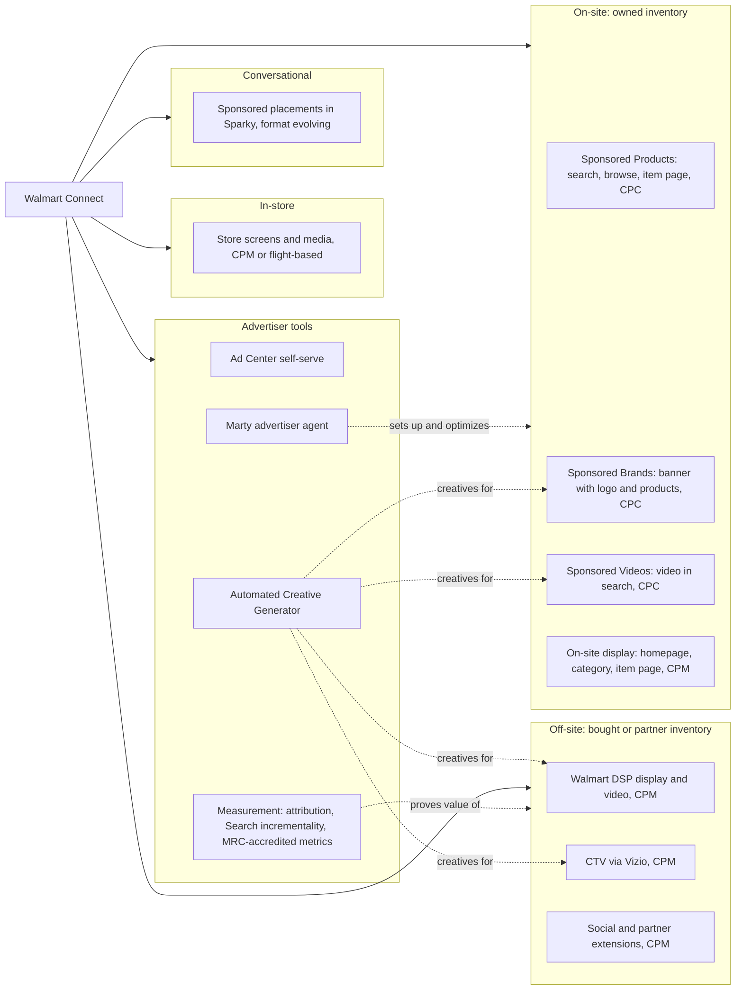

**How to read it**
- **On-site (owned).** These are the highest-margin, highest-intent placements. *Sponsored Products* is a product tile that looks like an organic result. Its creative is mostly the catalog image and title, so creative quality here means **catalog image quality**. *Sponsored Brands* is a banner with logo, headline, and several products. It is the first product where generated creative clearly matters. *Sponsored Videos* are video units in search. On-site display is CPM banners.
- **Billing.** Sponsored Products, Brands, and Videos are typically CPC on Walmart Connect. Display and video elsewhere are CPM. Verify exact current pricing models before you quote them.
- **Off-site.** Walmart DSP buys open-web inventory through The Trade Desk's technology, using Walmart's first-party audiences. These are first-price auctions, so bid shading matters. CTV through Vizio adds owned TV inventory plus TV viewing data. Social and partner extensions push Walmart audiences onto other platforms.
- **In-store.** Screens and other media across thousands of stores. Measurement relies on store-level or geo experiments because there is no click.
- **Conversational.** Ads inside the Sparky assistant are an emerging format. The creative is closer to a sponsored *answer* or product card than to a banner. Watch for this in the interview: it is a frontier creative problem.
- **Tools.** Ad Center is the self-serve UI and API. Marty is the agent that helps advertisers build and optimize campaigns. The Automated Creative Generator produces creative. Measurement covers attribution, Search incrementality reporting (2025), and MRC accreditation for Sponsored Search clicks and impressions (2025).
- **Dotted arrows from the Creative Generator** show that one creative system feeds many products. That is the argument for a *shared* creative platform instead of one per product.

**Say it in the interview:** "Creative matters differently by product. In Sponsored Products the creative is basically the catalog image, so image quality is the lever. In Sponsored Brands, video, DSP, and CTV the creative is a designed asset, so generation and adaptation are the levers. One creative platform should serve all of them, with adapters per placement."

---

## Diagram 4 — The full funnel, with metrics at each stage

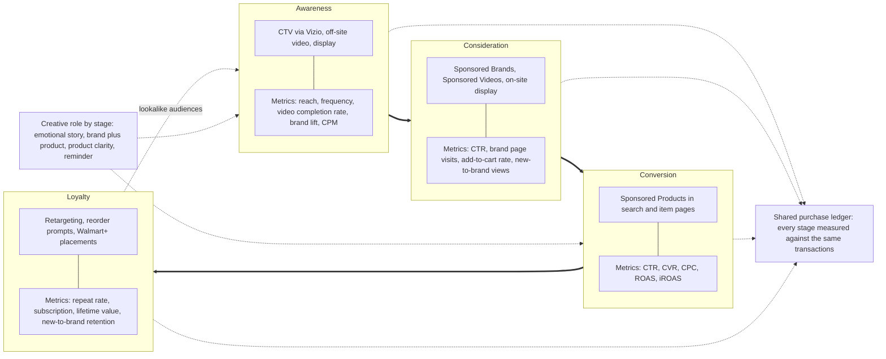

**How to read it**
- **Left to right is the shopper's journey.** Thick arrows show the shopper moving from first exposure to repeat purchase.
- **Awareness.** CTV and video reach shoppers before they have intent. You buy reach and frequency at CPM and measure brand lift. With closed-loop data you can also measure purchase lift, which is Walmart's differentiator against TV.
- **Consideration.** Sponsored Brands and Videos show a brand story next to products in search. Metrics are CTR, add-to-cart, and new-to-brand engagement.
- **Conversion.** Sponsored Products catches high-intent queries. This is CPC, ROAS-driven, and the highest volume.
- **Loyalty.** Retargeting and reorder prompts. Metrics are repeat purchase and lifetime value.
- **Dotted arrow from loyalty back to awareness.** Loyal buyers seed lookalike audiences for the next awareness campaign.
- **Shared purchase ledger.** Every stage is measured against the same transactions. That lets Walmart do full-funnel attribution. Most media companies can only measure one stage.
- **Creative role changes by stage.** Awareness creative is emotional and lifestyle. Conversion creative needs product clarity: a clean image, price, key attribute. A good creative model conditions on funnel stage and placement.

**Say it in the interview:** "The same product needs different creative at each funnel stage: lifestyle and story for CTV, brand plus product grid for Sponsored Brands, and maximum product clarity for Sponsored Products. So 'placement and objective' should be first-class inputs to the generator, not an afterthought."

---

## Diagram 5 — Advertiser campaign lifecycle

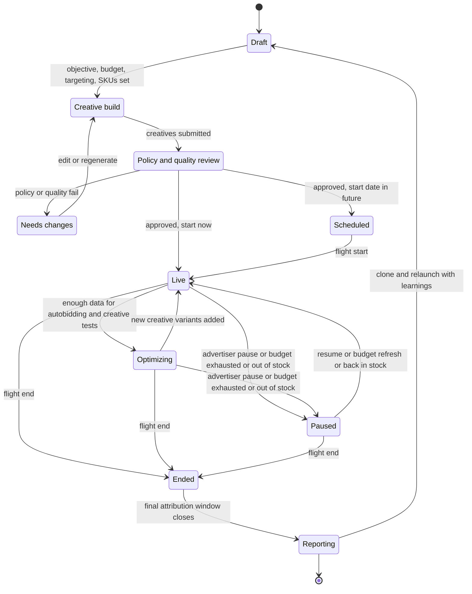

**How to read it**
- **Draft.** The advertiser (or Marty, for them) sets objective, budget, targeting or keywords, and which SKUs to promote.
- **Creative build.** For Sponsored Products the "creative" is mostly the catalog listing. For Sponsored Brands, video, and display, assets are uploaded or generated (Automated Creative Generator).
- **Review.** Policy (prohibited content, claims, trademark) plus quality (specs, legibility). Today this is often human-heavy. **Automated evaluation (Diagram 15) shrinks this state's latency.** Faster review means campaigns go live sooner, so revenue starts sooner.
- **Needs changes.** A rejection loops back to creative build. With generative tools the loop can be "regenerate with the critique", not "go back to your agency for a week".
- **Live and Optimizing.** These are separate because optimization needs data. Autobidding needs conversions, and creative tests need impressions. Adding new variants sends the campaign back to a learning phase.
- **Paused.** Retail-specific reasons include *out of stock* (never advertise what you can't sell) and budget exhaustion, as well as a manual pause.
- **Reporting comes after Ended.** Final numbers wait for the attribution window (for example 14 days post-click) to close.
- **Reporting back to Draft.** Clone and relaunch with what was learned. This is where creative insights ("lifestyle images beat white-background images in your category") create value.

**Say it in the interview:** "The two places creative intelligence changes this lifecycle are review and optimization. Automated, calibrated evaluation cuts time-to-live. Creative insights at reporting time make the next campaign better. Both are measurable: review latency and the next campaign's ROAS."

---

# Part B — Ads Serving ML

## Diagram 6 — A search ad request, end to end

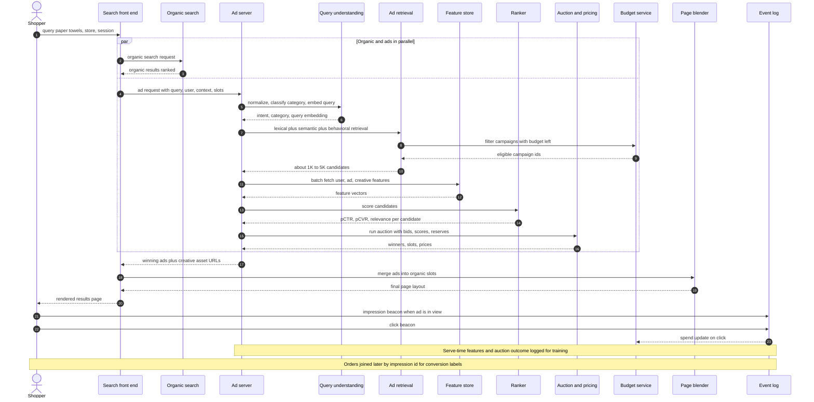

**How to read it**
- **Steps 1 to 3.** The shopper's query hits the search front end, which calls organic search and the ad server **in parallel** (the `par` block). Ads must fit inside organic's latency, so ads typically gets about 30 to 50 ms.
- **Query understanding.** Spell correction, category classification, intent, and a query embedding (cached for head queries).
- **Retrieval.** Pulls candidates from three sources: lexical (advertiser keywords, title match), semantic (two-tower ANN), and behavioral (co-view and co-buy). Then it filters by the **budget service** (campaigns with money left), stock at the shopper's store, and targeting rules.
- **Feature fetch.** One batched read for user, ad, and *creative* features. This is often the real latency bottleneck, not the model.
- **Ranker.** Scores each candidate with a multi-task model: pCTR, pCVR, relevance (Diagram 8).
- **Auction.** Combines bids and scores into eCPM, applies reserve and relevance floor, assigns slots, computes prices (Diagram 9).
- **Ad server returns winners plus creative asset URLs.** The creative itself is served from a CDN. The ad server only chooses *which* creative.
- **Page blender.** Merges ads into organic results at allowed positions. This is where ad load is enforced.
- **Beacons.** An impression is counted when the ad is *viewable*, not just served. That is part of what MRC accreditation audits. A click is a separate event, and the click updates spend in the budget service.
- **Notes at the bottom.** Features are logged *at serve time* so training uses exactly what serving saw (no skew). Orders arrive hours or days later and are joined by impression ID to create conversion labels.

**Say it in the interview:** "Ads runs in parallel with organic and gets maybe 30 to 50 milliseconds. Retrieval, feature fetch, multi-task ranking, auction, then blend. The ad server picks which creative to show but the pixels come from a CDN, so creative selection is a ranking problem and creative generation is offline. That separation is what lets us use expensive generative models without touching serving latency."

---

## Diagram 7 — Multi-stage funnel with candidate counts and latency budgets

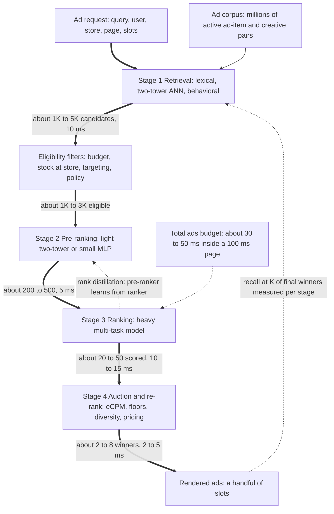

**How to read it**
- **Ad corpus.** Millions of eligible (item, campaign, creative) combinations. You cannot score them all with a heavy model at 100K+ QPS.
- **Retrieval (~10 ms).** Cheap, recall-oriented. Three retrievers union their results down to about 1K to 5K.
- **Eligibility filters.** Hard rules: budget left, *in stock at the shopper's store*, targeting, policy. Retail-specific: an ad for an out-of-stock item is wasted money and a bad experience.
- **Pre-ranking (~5 ms).** A small model trims to a few hundred. It is trained to imitate the ranker (the dotted *rank distillation* arrow) so it doesn't throw away what the ranker would love.
- **Ranking (~10 to 15 ms).** The heavy multi-task model on a few hundred candidates. Creative features enter here.
- **Auction and re-rank (~2 to 5 ms).** Economic logic plus page-level constraints: diversity, no two ads for the same item, ad load.
- **Rendered slots.** A handful of ads appear.
- **Dotted arrow from output back to retrieval.** Measure, for the final winners, whether each earlier stage would have kept them (recall at K). That shows which stage is losing good ads.
- **Budget note.** The latency numbers are illustrative. Say "order of magnitude" in the interview.

**Say it in the interview:** "It's a funnel of models with decreasing recall and increasing precision: millions to thousands to hundreds to tens to a handful, inside about 40 milliseconds. Generated creatives multiply the candidate count, because each item now has several creatives. So I'd do creative selection as a late, cheap stage after item ranking, not as more retrieval candidates."

---

## Diagram 8 — Ranking model architecture

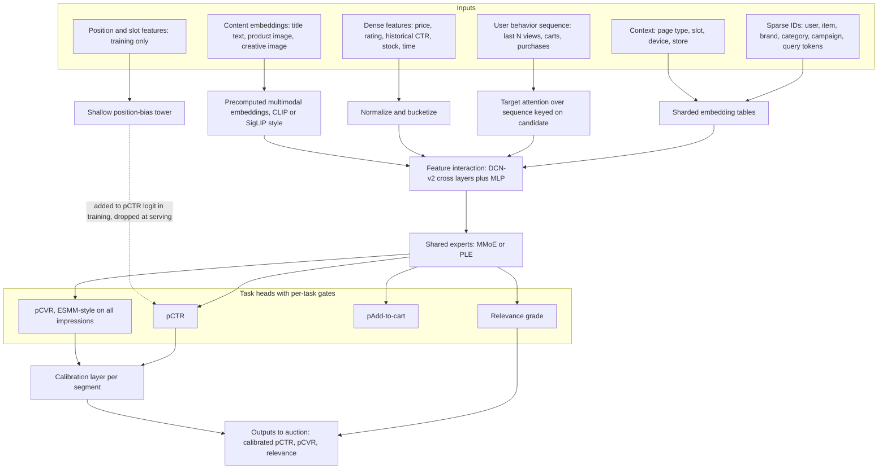

**How to read it**
- **Sparse IDs** go through large sharded embedding tables. These can reach hundreds of GB, which is why memory is often the serving bottleneck.
- **Behavior sequence** goes through *target attention*: the candidate item is the query, so "which past events matter for *this* candidate" (DIN, DIEN, or transformer style).
- **Dense features** are normalized or bucketized. Historical CTR features are powerful but give cold-start items nothing, which is why content features matter.
- **Content embeddings, including the creative image.** This is the creative intelligence hook. Precomputed multimodal embeddings of product image, title, and *creative* let the ranker generalize to new creatives with zero history. Structured creative attributes (Diagram 16) also enter as features.
- **Feature interaction.** DCN-v2 cross layers learn explicit feature crosses, plus an MLP.
- **Shared experts plus gates (MMoE or PLE).** The tasks share representations. The gates let them diverge where they conflict.
- **Heads.** pCTR, pCVR (ESMM-style, trained over all impressions to avoid sample selection bias), add-to-cart, relevance.
- **Position-bias tower.** Learns "slot 1 gets clicked more regardless of quality". It is used only in training so the main model learns position-free quality, and dropped at serving.
- **Calibration layer.** The auction multiplies probabilities by bids, so probabilities must be *calibrated*, not just well-ranked. Calibration is done per segment (category, placement, new vs. old ads).

**Say it in the interview:** "Creative enters the ranker as content embeddings plus structured attributes. That gives a new generated creative a sensible pCTR before it has any impressions, which is the cold-start problem generative creative creates. It also means the creative performance model and the ranker can share an image encoder."

---

## Diagram 9 — Auction and pricing

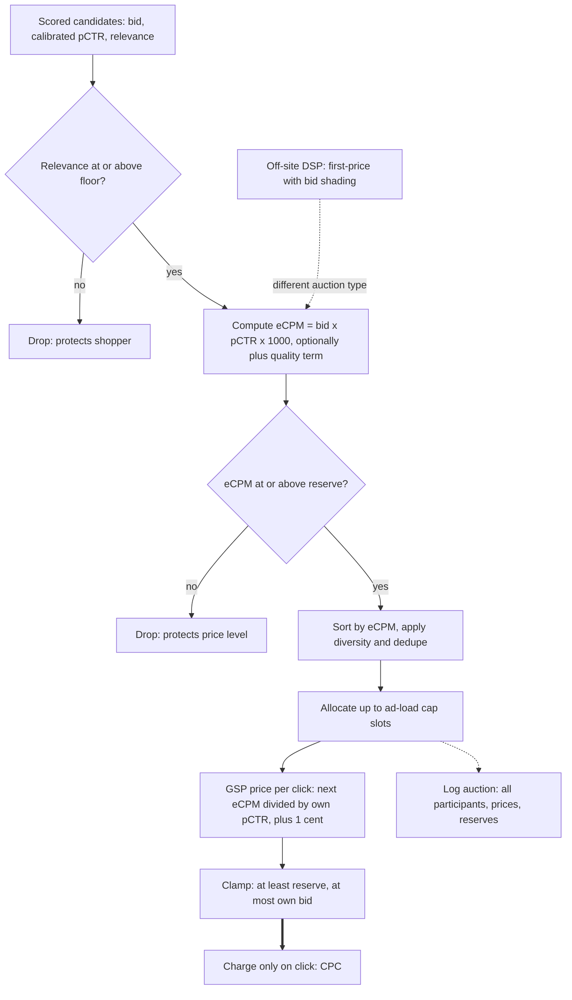

**How to read it**
- **Candidates** come in with a bid (from the advertiser or autobidder), calibrated pCTR, and relevance.
- **Relevance floor first.** No amount of money buys an irrelevant ad into the page. This is the shopper's protection, and it is a hard filter.
- **eCPM** = bid x pCTR x 1000. It turns a CPC bid into expected revenue per thousand impressions, so ads with different bids and CTRs can be compared. Some systems add a quality or relevance term (Diagram 2's alpha).
- **Reserve price.** A minimum eCPM. It protects price levels in thin auctions. It can be learned per query or category.
- **Sort, dedupe, diversify, allocate.** Up to the ad-load cap.
- **GSP pricing.** The winner in slot *i* pays the minimum bid needed to keep the slot: `price_i = eCPM_(i+1) / (pCTR_i x 1000) + 0.01`, clamped between reserve and own bid.
- **Worked example.** A: bid $1.00, pCTR 0.05, eCPM 50. B: bid $2.00, pCTR 0.02, eCPM 40. C: bid $0.80, pCTR 0.03, eCPM 24. A wins slot 1 *despite the lower bid* and pays 2.00 x 0.02 / 0.05 + 0.01 = **$0.81**. B pays 0.80 x 0.03 / 0.02 + 0.01 = **$1.21**.
- **Creative tie-in.** A better creative raises pCTR. In GSP that means the advertiser *wins higher slots and pays less per click*. That is the advertiser-facing pitch for creative quality.
- **Off-site (dotted).** DSP open-web auctions are mostly first-price, so the bidder shades bids down to the expected clearing price.
- **Log every participant**, not just winners. Counterfactual analysis and reserve-price learning need the losers.

**Say it in the interview:** "In a quality-weighted second-price auction, a better creative raises pCTR, so the advertiser wins a better slot and pays less per click. That's the cleanest advertiser-facing ROI story for creative intelligence: better creative is cheaper media."

---

## Diagram 10 — Autobidding and pacing control loop

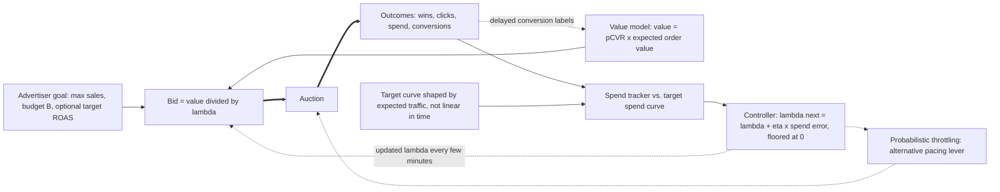

**How to read it**
- **Goal.** The advertiser sets an objective and constraints, not per-keyword bids.
- **Value model.** Expected value of a click or impression: pCVR times order value. Calibration errors here become direct overspending or underspending.
- **Bid = value / lambda.** From the Lagrangian dual of "maximize value subject to budget". Lambda is the shadow price of budget. High lambda means budget is scarce, so bid lower.
- **Auction and outcomes.** Thick arrows: bids go into auctions and produce wins, clicks, spend, conversions.
- **Spend tracker vs. target curve.** The target is shaped by expected traffic (more spend at evening peaks), not a straight line through the day.
- **Controller.** Online dual gradient step or PID. Overspending raises lambda (bids fall). Underspending lowers it (bids rise).
- **Dotted feedback.** Lambda updates every few minutes. Conversions arrive late and retrain the value model.
- **Throttling.** An alternative lever: join each auction with probability p. It is simpler but less efficient than bid scaling.
- **Creative interaction.** When a creative test changes CTR, the controller sees a spend change and adjusts lambda. Creative experiments and autobidding interact, so budget-split designs are needed to measure creative lift cleanly.

**Say it in the interview:** "Autobidding is value prediction plus a one-dimensional controller on lambda. For creative work the key point is that creative experiments run *inside* this loop. If a variant raises CTR the pacer reacts, so I'd measure creative lift with budget-split or advertiser-level randomization, not naive impression splits."

---

## Diagram 11 — Training data flow

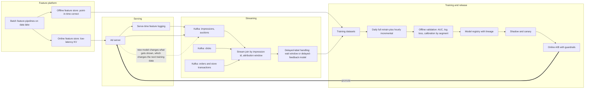

**How to read it**
- **Serve-time feature logging.** Log exactly the features the model saw. Recomputing them later creates training-serving skew, a classic silent bug.
- **Three Kafka streams.** Impressions with auctions, clicks, and orders (online plus store transactions where they can be linked).
- **Stream join by impression ID within the attribution window.** Clicks join in seconds. Orders can take up to the full attribution window, for example 14 days.
- **Delayed labels.** Either wait (stale but clean) or train now and correct for not-yet-arrived conversions (delayed-feedback models, Chapelle 2014). Retail has long conversion delays, so this matters.
- **Feature platform.** Batch pipelines fill both the *offline* store (point-in-time joins for training) and the *online* store (low-latency lookup at serving). Same definitions in both prevents skew.
- **Training cadence.** Daily full retrain plus frequent incremental updates, because ads are non-stationary (new items, promos, holidays).
- **Validation.** AUC and log loss, plus **calibration by segment**. A model can improve AUC and break calibration, and the auction would overcharge.
- **Registry, shadow, canary, A/B.** Lineage (data snapshot, code, config), then shadow scoring, then a small-traffic canary, then a full experiment with guardrails (GMV per search, latency, organic CTR).
- **Dotted feedback loop.** The model decides what gets shown, which decides what data exists. Without exploration traffic the model only learns about what it already likes. This matters double for generated creatives, which start with no data.
- **Creative tie-in.** The same pipeline carries `creative_id` and creative features, so the creative performance model (Diagram 18) trains on the same joined logs.

**Say it in the interview:** "Logs, a stream join with delayed labels, point-in-time features, train, validate calibration, registry, canary. The thing I'd add for creative is making creative ID and creative attributes first-class columns in these logs from day one. Otherwise you can't learn which creative attributes work, and you can't close the loop to the generator."

---

## Diagram 12 — Measurement: attribution and incrementality

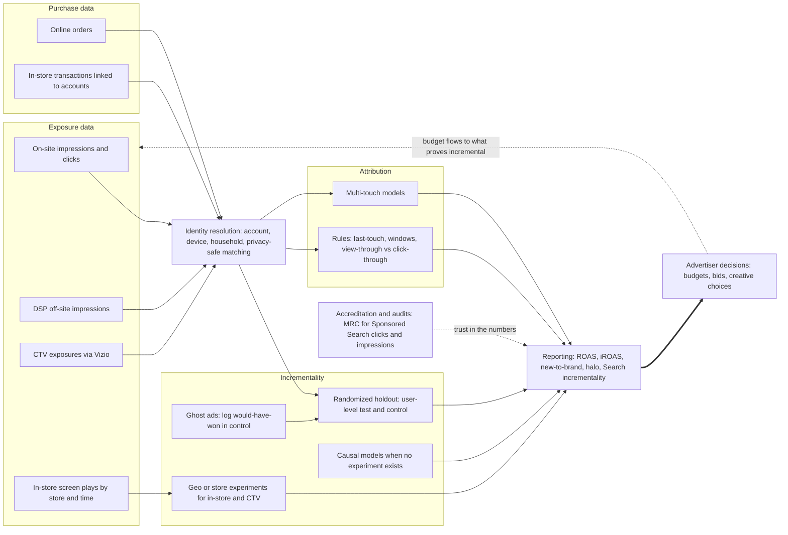

**How to read it**
- **Exposure data** comes from four very different sources. On-site is user-level and precise. DSP and CTV need cross-device matching. In-store screens only know store and time.
- **Purchase data.** Online orders are exact. In-store transactions can be linked when the shopper uses the app, account, or a linked payment method. Coverage is not 100%, so hedge.
- **Identity resolution** joins exposures to purchases at account or household level, with privacy controls (aggregation thresholds, clean-room-style access for advertisers). Specifics are not public.
- **Attribution** credits sales to ads by rules (last-touch in a 14-day window, view-through vs. click-through) or models. Attribution answers "which ads were near the sale", not "which ads *caused* the sale".
- **Incrementality** answers causation. Randomized holdouts withhold ads from a control group. **Ghost ads** log, in control, which ad *would* have won, so you compare like with like. Geo or store experiments cover in-store and CTV. Causal models fill gaps.
- **Note in-store screens go straight to geo or store experiments.** There is no user-level exposure.
- **Reporting.** ROAS, iROAS, new-to-brand, halo (lift on other products from the same brand). Walmart launched Search incrementality reporting in 2025.
- **MRC accreditation (dotted)** is third-party auditing of how clicks and impressions are counted. It makes the numbers trusted currency for big advertisers.
- **Loop back to exposure.** Advertisers move budget to whatever *proves* incremental. Measurement drives revenue.
- **Creative tie-in.** Creative A/B tests should report *incremental* lift, not CTR alone. A clickbait creative can raise CTR and lower iROAS.

**Say it in the interview:** "Attribution tells you which ads were near the sale. Incrementality, through holdouts, ghost ads, and geo tests, tells you which ads caused it. For creative, I'd make sure our success metric is incremental conversion per dollar, because optimizing generated creative on CTR alone will find clickbait."

---

# Part C — Creative Intelligence (the role)

## Diagram 13 — Where creative sits in the ads system

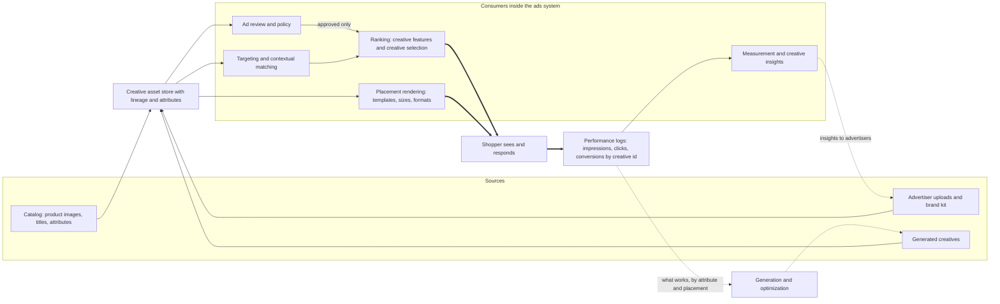

**How to read it**
- **Three sources of creative.** The catalog (for Sponsored Products the creative *is* the catalog listing), advertiser uploads with a brand kit, and generated creatives.
- **Creative asset store.** This is the single hub. Every asset carries lineage (who or what made it, which model version) and extracted attributes (Diagram 16).
- **Ad review and policy** consumes assets first. Only approved assets reach ranking.
- **Ranking** uses creative features (embeddings, attributes) to predict CTR and chooses *which creative* to show for an ad in this context.
- **Placement rendering** needs the right size and format: search tile, banner, CTV 16:9, vertical video.
- **Targeting and contextual matching** use creative attributes, for example matching a "back to school" creative to back-to-school queries.
- **Measurement and insights** report creative performance by attribute back to advertisers.
- **Thick arrows** are the shopper path: ranked, rendered creative reaches the shopper, and their response becomes performance logs keyed by creative ID.
- **Dotted feedback** is the learning loop. Performance by attribute and placement feeds generation (make more of what works). Insights go back to advertisers (upload more of what works).
- **Key point.** Creative is not a side feature. It touches review, ranking, rendering, targeting, and measurement. That's why the job description says creative *attributes* should be consumed by targeting, recs, and measurement.

**Say it in the interview:** "I think of the creative asset store as a hub with five consumers: review, ranking, rendering, targeting, and measurement. Performance flows back into generation. The org leverage is making creative a structured, versioned, queryable object that every one of those teams can use, not a JPEG URL."

---

## Diagram 14 — Generative creative pipeline (data flow)

The centerpiece. Be able to draw a simplified version (see practice section).

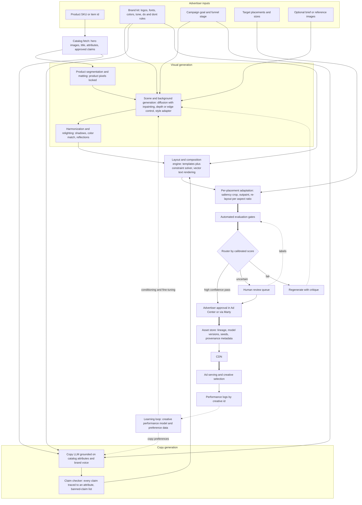

**How to read it**
- **Inputs.** The SKU anchors everything to a real product. The brand kit sets visual and verbal identity, including hard rules ("never put the logo on a dark background"). Goal and funnel stage set the style (lifestyle vs. product clarity). Placements set the output sizes. A brief or reference is optional.
- **Catalog fetch.** Pulls the hero images, title, attributes, and *approved claims*. The catalog is the source of truth for both pixels and words. That is how you prevent hallucinated products and claims.
- **Segmentation and matting: product pixels locked.** The most important design choice. **Never regenerate the product.** Cut it out precisely (SAM-style segmentation plus alpha matting for edges, hair, glass) and composite it. A generated product that looks slightly different is a false advertisement and a brand-trust failure.
- **Scene generation.** Diffusion *inpaints around* the locked product mask. Control signals (depth, edges) keep perspective plausible. A style adapter applies brand look. Funnel stage picks lifestyle vs. clean studio.
- **Harmonization and relighting.** Composites look fake without matched lighting, contact shadows, and color temperature. This step is what makes a composite look photographed.
- **Copy LLM, grounded.** Headlines and CTAs are generated from catalog attributes and brand voice only. The **claim checker** traces every claim ("24 rolls", "plant-based") back to an attribute and blocks banned or regulated claims (health, "best", price claims that can go stale).
- **Layout and composition engine.** Templates plus a constraint solver: logo safe zone, text legibility, product prominence, brand colors. **Text is rendered as vector type, not by the diffusion model.** That removes misspellings and gives pixel-exact brand fonts.
- **Per-placement adaptation.** One master creative becomes many: 1:1 tile, 300x250, 728x90, 16:9 CTV with TV-safe area, 9:16 vertical. Saliency-aware crop where it fits, outpaint where you need more canvas, full re-layout where the aspect ratio change is extreme (a 728x90 leaderboard is not a crop of a square).
- **Evaluation gates and router (Diagram 15).** Each candidate gets a calibrated score. High-confidence passes go to the advertiser. Uncertain ones go to humans. Failures regenerate *with the critique* as feedback (dotted arrow back to scene generation).
- **Human review labels (dotted arrow into evaluation).** Every human decision is training and calibration data for the judge.
- **Advertiser approval.** The advertiser stays in control. In Ad Center, or conversationally through Marty.
- **Asset store with lineage.** Model versions, prompts, seeds, and provenance metadata (C2PA-style content credentials) for audit, reproducibility, and AI-disclosure needs.
- **CDN, serving, performance logs.** Serving picks among approved variants. Performance is logged by creative ID.
- **Learning loop (dotted).** The creative performance model and preference data feed back as conditioning ("lifestyle scenes work for this category") and fine-tuning for both the visual and copy generators (Diagram 18).

**Say it in the interview:** "The two design principles I'd defend are: the product's pixels are sacred, so we segment and composite instead of regenerating, and the words are grounded, so every claim traces to a catalog attribute and text is rendered as vector type. Everything after that is about scaling: per-placement adaptation, calibrated automated evaluation so humans only see the uncertain cases, and logging by creative ID so performance can teach the generator."

---

## Diagram 15 — Automated evaluation: the model-as-judge system

The second centerpiece. This is where your rigor shows.

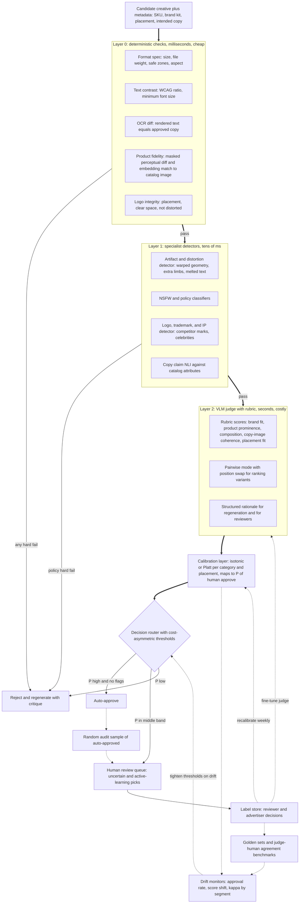

**How to read it**
- **Cascade by cost.** Cheap checks run first and kill obvious failures, so the expensive VLM judge only sees plausible candidates. Same funnel logic as ad serving (Diagram 7), applied to quality.
- **Layer 0: deterministic.** No model judgment needed. Spec compliance. WCAG contrast (for example 4.5:1 for body text). **OCR diff**: read the rendered creative and confirm the text matches the approved copy exactly. **Product fidelity**: compare the product region to the catalog image (perceptual diff plus embedding similarity). Since the product was composited, any drift means a pipeline bug. Logo integrity.
- **Layer 1: specialist detectors.** Narrow models that beat a general VLM on their one job. Artifacts and distortion (generated-image failure modes). NSFW and policy. Trademark, competitor logos, likeness. **Claim NLI**: does each sentence in the copy follow from the catalog attributes?
- **Layer 2: VLM judge with a rubric.** Scores what rules can't: brand fit, product prominence, composition, copy-image coherence, fit for the placement. **Pairwise mode with position swap** compares variants and controls for the judge's known position bias. **Structured rationale** gives the regenerator something to act on, and gives reviewers a head start.
- **Calibration layer.** The key Distinguished-level idea. Raw judge scores are not probabilities. Fit isotonic or Platt mappings from judge outputs to *P(human approves)*, per category and placement, on held-out human labels. Now a threshold means something: "auto-approve when P is above 0.97" has a measurable false-approval rate.
- **Cost-asymmetric router.** Approving a bad creative (brand damage, policy violation) costs far more than sending a good one to review. So the auto-approve threshold is high, the reject threshold is low, and the middle band goes to humans. Thresholds can differ by risk tier: a regulated category like alcohol or OTC health gets stricter rules or always-human review.
- **Active learning.** The human queue gets uncertain items *plus* the most informative ones for improving the judge. Reviewer time is spent where it teaches the most.
- **Random audit of auto-approved (dotted).** Without this you can't estimate the false-approval rate of the automated path. That makes it the most important monitoring sample.
- **Label store feeds three things.** Weekly recalibration, judge fine-tuning, and growing golden sets.
- **Drift monitors.** Approval rate, score distributions, and judge-human agreement (Cohen's kappa) by segment. A new generator version or a new category can shift the score distribution. On drift, tighten thresholds automatically, which sends more to humans, until the judge is recalibrated.
- **Also connect to outcomes.** Over time, check that judge scores predict *online* performance and advertiser acceptance, not just reviewer approval. That validates the rubric itself.

**Say it in the interview:** "I treat the judge as a measurement instrument that has to be calibrated against people. A cheap-to-expensive cascade, a VLM rubric judge, a calibration layer that turns scores into P(human approves) per segment, and a cost-asymmetric router. Then a random audit of auto-approvals so we always know our false-approval rate, and drift monitors that send more to humans when the judge goes out of calibration."

---

## Diagram 16 — Creative understanding: the signal platform

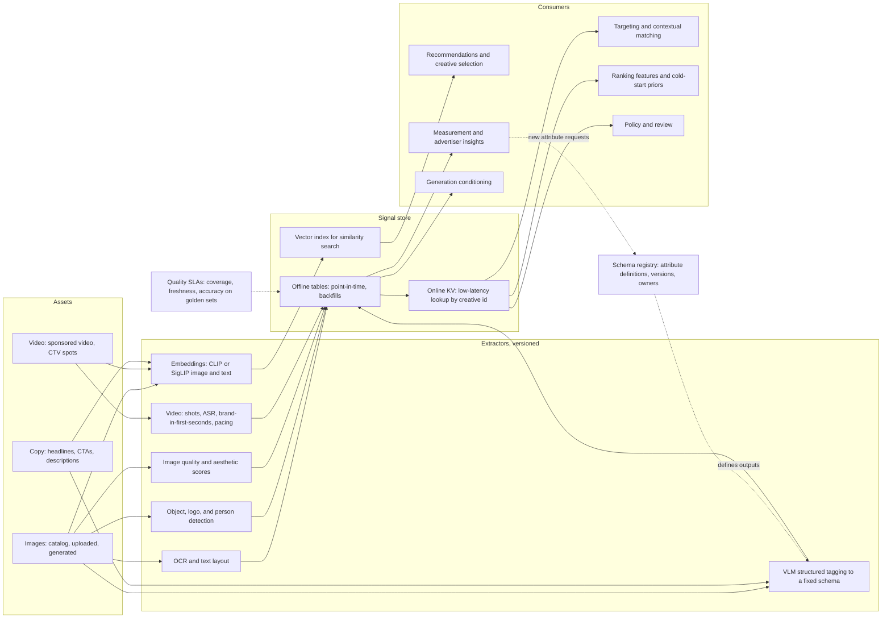

**How to read it**
- **Assets.** Every creative regardless of origin: catalog, uploaded, generated, video, copy.
- **Extractors.** Each is a versioned model. OCR and text layout (text density, price present). Detection (product count, people present, logo position). Embeddings for similarity and as dense ranking features. **VLM structured tagging to a fixed schema**, for example `setting: studio | lifestyle-indoor | lifestyle-outdoor`, `message: price | benefit | promo | seasonal`, `people: none | hands | person`, `dominant_colors`, `text_density`. Quality and aesthetic scores. Video-specific signals: shot count, ASR transcript, whether the brand appears in the first seconds, pacing.
- **Schema registry.** The governance piece. Each attribute has a definition, allowed values, a version, and an owner. Without this, attributes drift silently and consumers break. Changing the tagger prompt is a *schema version bump*, with backfill.
- **Signal store, three shapes.** Offline tables with point-in-time correctness for training and analysis. Online KV for serving-time features. A vector index for "find similar creatives".
- **Quality SLAs.** Coverage (percentage of live creatives tagged), freshness (minutes from upload to tagged), and accuracy on golden sets. Consumers depend on these like any data contract.
- **Consumers.** Targeting (match creative themes to queries or audiences). Ranking (attributes and embeddings as features, which gives a cold-start pCTR prior for new creatives). Creative selection (pick the best variant for context). Measurement and insights ("lifestyle imagery lifts CTR in home goods" for advertisers). Generation conditioning (generate the attributes that work). Policy and review.
- **Dotted loop from insights to registry.** Analysts and advertisers ask for new attributes. They go through the registry, not ad hoc.
- **Why this is platform work.** One extraction investment, six consumers. This is the "structured creative attributes consumed by targeting, recs, and measurement" line in the job description.

**Say it in the interview:** "I'd build creative understanding as a data product with a schema registry, versioned extractors, an offline, online, and vector store, and coverage and freshness SLAs. The VLM tagger is just one versioned extractor. The value is that ranking, targeting, recs, measurement, and generation all read the same attributes, so 'lifestyle image' means the same thing everywhere."

---

## Diagram 17 — Video ad generation and adaptation

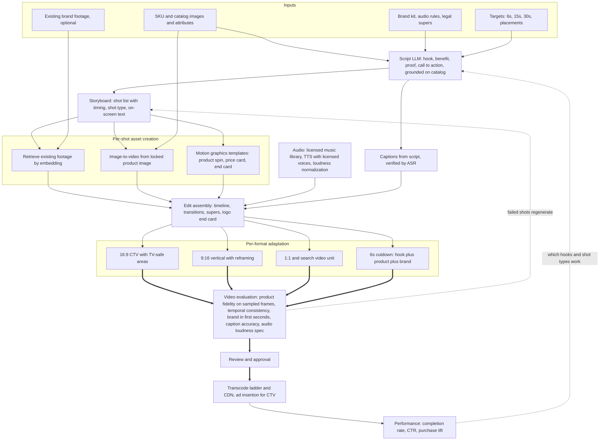

**How to read it**
- **Inputs.** Same SKU and brand anchors as images, plus audio rules (sonic logo, voice), legal supers ("see store for details"), and target durations and placements.
- **Script LLM.** A short ad has a known structure: hook, benefit, proof, call to action. It is grounded on catalog attributes like the copy in Diagram 14.
- **Storyboard.** Turns the script into a shot list with timing and shot types. This is the intermediate representation that makes video *controllable and editable*. Advertisers edit the storyboard, not pixels.
- **Per-shot creation, three paths in order of preference.** (1) Retrieve real brand footage if it exists, which is safest. (2) Image-to-video from the *locked* product image (subtle camera moves, not reinventing the product). (3) Motion-graphics templates (product spin, price card, end card), which are deterministic and on-brand.
- **Audio.** Licensed music and voices only (IP safety). Normalize loudness to the platform spec. TV has strict loudness standards. Check the exact spec for each placement.
- **Edit assembly.** A timeline with transitions, supers, and logo end card. Assembled programmatically.
- **Captions.** Generated from the script, then verified with ASR so they match the actual audio.
- **Per-format adaptation.** CTV 16:9 with TV-safe areas. Vertical 9:16 needs *reframing*: track the subject, re-place text. Square and the search video unit. A **6-second cutdown** is a re-edit, not a trim: hook, product, brand.
- **Video evaluation.** Product fidelity on sampled frames (video models can drift the product over time). Temporal consistency (flicker, morphing). Brand in the first seconds (completion drops fast). Caption accuracy. Audio spec.
- **Transcode, CDN, ad insertion.** A bitrate ladder per device. CTV typically uses server-side ad insertion.
- **Feedback.** Completion and purchase lift by hook type and shot type feed the script model. Failed shots regenerate at the storyboard level, not the whole video.

**Say it in the interview:** "For video I'd generate a storyboard as an editable intermediate, then fill each shot by preference: real footage first, image-to-video from the locked product image second, motion templates third. Adaptation to CTV, vertical, and 6-second cutdowns is a re-edit, not a crop. Evaluation has to sample frames for product drift, because video models drift over time."

---

## Diagram 18 — Creative optimization loop

```mermaid
flowchart LR
    G1["Generate N variants per ad"]
    E1["Eval gates: only safe, on-brand variants pass"]
    B1["Serve with Thompson sampling per ad and placement"]
    P1["Hierarchical priors from creative attributes: cold start"]
    O1["Outcomes: impressions, clicks, conversions by variant"]
    D1["Debias: position, placement, audience mix"]
    M1["Creative performance model: predicts lift from creative features plus context"]
    R1["Reward model: performance plus judge quality plus policy constraints"]
    PR["Preference pairs: winner vs loser variants, same product and context"]
    FT["Generator update: DPO or reward-weighted fine-tune, or prompt policy update"]

    subgraph GUARD["Guards against reward hacking"]
        K1["KL penalty to reference generator"]
        K2["Hard eval gates never bypassed"]
        K3["Held-out human eval each release"]
        K4["Diversity floor across variants"]
        K5["Optimize incremental conversion, not CTR alone"]
    end

    G1 ==> E1
    E1 ==> B1
    P1 -.-> B1
    B1 ==> O1
    O1 --> D1
    D1 --> M1
    M1 --> R1
    M1 -.->|"feature for ranking and selection"| B1
    D1 --> PR
    R1 --> FT
    PR --> FT
    GUARD -.-> FT
    FT ==>|"next generation round"| G1
```

**How to read it**
- **Generate N variants.** For example 4 to 8 per ad, deliberately diverse in attributes (scene type, copy angle) so the loop learns something.
- **Eval gates.** Only variants that pass Diagram 15 can be explored. Exploration never relaxes safety.
- **Thompson sampling per ad and placement.** It balances showing the current best variant with learning about others. Each variant has a posterior over CTR or conversion rate. Sample, show the argmax.
- **Hierarchical priors (cold start).** Most ads have little traffic. Priors from the creative performance model, pooled across advertisers by attribute, let low-traffic ads benefit from what was learned elsewhere.
- **Debias.** Raw CTR differences are confounded by position, placement, and audience. Correct for these before learning, or the loop learns "variant B got slot 1 more".
- **Creative performance model.** Predicts lift from creative features plus context. It also feeds ranking and selection (dotted arrow).
- **Reward model.** Combines predicted performance, judge quality, and policy constraints into one scalar. This is what you optimize.
- **Preference pairs.** Winner vs. loser variants for the *same* product and context make clean pairwise data. That suits DPO-style training.
- **Generator update.** DPO or reward-weighted fine-tuning of the diffusion or LLM generator, or a cheaper first step: update the *prompt or conditioning policy* (which scene types to request) without touching weights.
- **Guards against reward hacking.** This is where you show seniority. KL to a reference model stops collapse onto weird high-reward outputs. Hard gates are never bypassed. Held-out human eval on every release. A diversity floor prevents mode collapse (every ad looking the same). **Optimize incremental conversion, not CTR**, because CTR-optimized creative drifts toward clickbait and misleading cues.
- **Loop.** The next generation round starts from the updated generator.

**Say it in the interview:** "Generate diverse variants, gate them, explore with Thompson sampling using attribute-level priors for cold start, debias, then turn winner-loser pairs into preference data for the generator. The first version of 'learning' should just update the prompt and conditioning policy. Fine-tune weights only once guards are in place: KL, hard gates, human holdouts, a diversity floor, and an incremental-conversion reward instead of CTR."

---

## Diagram 19 — Shared platform layering

```mermaid
flowchart TD
    subgraph APPS["Product applications"]
        P1["Automated Creative Generator"]
        P2["Marty advertiser agent"]
        P3["Sponsored Brands builder"]
        P4["DSP and CTV creative tools"]
        P5["Catalog image enhancement"]
        P6["Sparky ad formats"]
    end

    subgraph SVC["Shared creative services"]
        S1["Generation gateway: model routing, quotas, caching, prompt templates"]
        S2["Evaluation harness: offline benchmarks plus online judge service"]
        S3["Creative signal store and schema registry"]
        S4["Policy and brand-safety service"]
        S5["Asset store with lineage and provenance"]
        S6["Experimentation and bandit service"]
        S7["Human review tooling and label store"]
    end

    subgraph INFRA["Infrastructure"]
        F1["GPU pool: batch and online inference, training"]
        F2["Model registry and deployment"]
        F3["Feature store"]
        F4["Data lake and streaming logs"]
        F5["Observability: cost, latency, quality dashboards"]
    end

    P1 --> S1
    P1 --> S2
    P2 --> S1
    P2 --> S6
    P3 --> S1
    P3 --> S4
    P4 --> S1
    P4 --> S5
    P5 --> S2
    P6 --> S4
    S1 --> F1
    S1 --> F2
    S2 --> F1
    S2 --> S7
    S3 --> F3
    S3 --> F4
    S5 --> F4
    S6 --> F4
    S4 --> F2
    F5 -.-> S1
    F5 -.-> S2
```

**How to read it**
- **Top: product applications.** Customer-facing tools, each owned by a product team. The Automated Creative Generator, Marty (which calls generation and experimentation as tools), the Sponsored Brands builder, DSP and CTV creative tools, catalog image enhancement (improves Sponsored Products creative for free), and new Sparky formats.
- **Middle: shared creative services.** This is the platform the role should own or shape.
  - **Generation gateway.** One entry point to all generative models. Routes requests to the right model and version, enforces quotas, caches, and owns prompt templates. Swapping a model is a config change, not six code changes.
  - **Evaluation harness.** Offline benchmarks (golden sets, regression suites for every model release) *and* the online judge service from Diagram 15. Same rubric in both, so offline wins predict online.
  - **Signal store and schema registry** (Diagram 16).
  - **Policy and brand-safety service.** One policy implementation, versioned. Every product calls it.
  - **Asset store** with lineage and provenance.
  - **Experimentation and bandit service** for creative tests and Thompson sampling.
  - **Human review tooling and label store.** Labels are a shared asset across products.
- **Bottom: infrastructure.** GPU pool (shared between batch generation, online judging, and training), model registry, feature store, data lake, observability. Track *cost per approved creative*, not just cost per generation.
- **Arrows show dependencies.** Apps call services, and services run on infra. No app should call a model directly. If it does, you lose eval, policy, lineage, and cost control.
- **Why this matters in the interview.** A Distinguished scientist is judged on leverage. Building the middle layer means every new product launch gets eval, policy, and measurement for free.

**Say it in the interview:** "My test for platform health is whether a new creative product can launch without writing its own eval, policy check, or asset lineage. If every app goes through the generation gateway and the eval harness, we get one quality bar, one cost dashboard, and one place to swap models."

---

## Diagram 20 — Sequenced roadmap

Hedge in the interview: "Before committing to this I'd spend the first weeks learning what exists. This is the shape, not the plan."

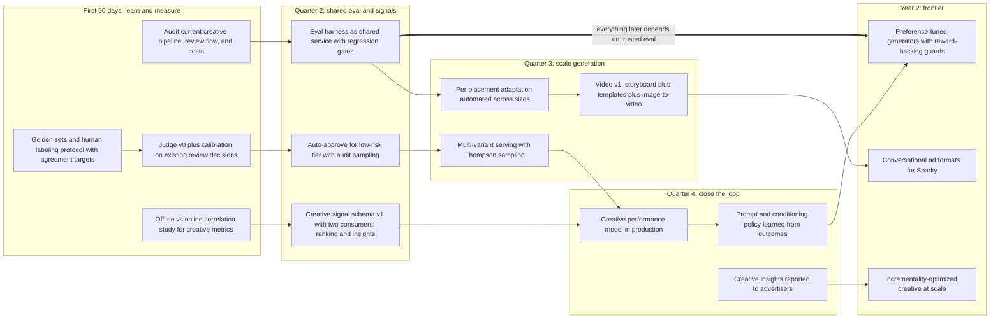

**How to read it**
- **First 90 days: learn and measure.** Audit what exists before building. Golden sets and a labeling protocol with inter-rater agreement targets come first, because you can't calibrate a judge against noisy labels. Judge v0 calibrated on *existing* review decisions, which is free labeled data. Check whether offline creative metrics predict online results.
- **Quarter 2: shared eval and signals.** Make the eval harness a service with regression gates on every model release. Turn on auto-approve only for the lowest-risk tier, with audit sampling. That gives a visible win (review latency down) at controlled risk. Signal schema v1 with exactly two consumers to prove the contract.
- **Quarter 3: scale generation.** Automate per-placement adaptation (big production-cost savings). Multi-variant serving with bandits starts producing outcome data. Video v1 with a controllable storyboard approach.
- **Quarter 4: close the loop.** The creative performance model goes into production as a ranking feature and selection prior. Learn the prompt and conditioning policy from outcomes (cheap, reversible). Start creative insights for advertisers.
- **Year 2: frontier.** Preference-tuned generators, conversational ad formats, and optimization for incremental conversion at scale.
- **Arrows are dependencies, not just order.** Auto-approve depends on a calibrated judge. The performance model depends on both signals and bandit data. The thick arrow says the whole roadmap rests on trusted evaluation.
- **Each quarter ships something measurable.** Time-to-approve, cost per approved creative, creative-attributed CTR lift, then iROAS lift.

**Say it in the interview:** "I'd sequence it eval first, because every later step, from auto-approval to bandits to preference tuning, is only as good as our ability to measure quality and calibrate it to humans. Each quarter ships a measurable win: review latency, then production cost, then CTR lift, then incremental ROAS."

---

# ASCII fallbacks (three most important diagrams)

Use these if Mermaid doesn't render. The serving funnel (Diagram 7) already has an ASCII version at the top of [03_recsys_ranking_at_scale.md](03_recsys_ranking_at_scale.md).

### Fallback for Diagram 1 — Money flow and closed loop

```
 BUDGETS            ADVERTISERS                 WALMART CONNECT                 SURFACES            SHOPPER
 trade/shopper ──► 1P suppliers ──$ CPC──►  Ad Center (self-serve)  ┐
 brand/media   ──► 3P sellers   ──$ CPC──►  Managed service         ├─► Ad server ──► On-site search/browse ──┐
               └─► Agencies     ──$ CPM──►  Walmart DSP (TTD tech)  ┘   auction       Off-site web (via DSP)──┤
                                              │ $ media cost             billing       CTV (Vizio)            ├─► Shoppers ──$──► Purchases
                                              └──────────► 3rd-party publishers         In-store screens       │                (online + store)
                                                                                         Sparky assistant ──────┘                      │
                                                                                                                                       │
          ▲                                     impression/click logs ─────────┐                                                       │
          │                                                                    ▼                                                       │
          └──── budget + bid changes ◄── Reporting: ROAS, iROAS, NTB ◄── CLOSED LOOP: exposures JOIN transactions ◄── order logs ──────┘
```

### Fallback for Diagram 14 — Generative creative pipeline

```
 INPUTS: SKU | brand kit | goal/funnel stage | placements | optional brief
    │
    ▼
 Catalog fetch (images, title, attributes, approved claims)
    │                                   │
    ▼                                   ▼
 Segment + matte product          Copy LLM (grounded on attributes + brand voice)
 (PRODUCT PIXELS LOCKED)                │
    │                                   ▼
    ▼                             Claim checker (every claim -> attribute)
 Scene/background gen                   │
 (inpaint around mask, control,         │
  brand style)                          │
    │                                   │
    ▼                                   │
 Harmonize / relight                    │
    │                                   │
    └──────────────┬────────────────────┘
                   ▼
 Layout engine (templates + constraints, VECTOR TEXT)
                   │
                   ▼
 Per-placement adaptation (crop / outpaint / re-layout: 1:1, 300x250, 728x90, 16:9 CTV, 9:16)
                   │
                   ▼
 Automated eval gates ──► Router ──► pass ──────────────► Advertiser approval ──► Asset store (lineage) ──► CDN ──► Serving
                            │  └───► uncertain ─► Human review ─┘   │                                                    │
                            │                       │ labels ─► back to eval                                            │
                            └──────► fail ─► regenerate with critique ─► back to scene gen                             ▼
                                                                                                         Performance logs by creative id
                                                                                                                         │
                     ◄──────────────── learning loop: conditioning + fine-tuning for image and copy generators ◄─────────┘
```

### Fallback for Diagram 15 — Model-as-judge evaluation

```
 Candidate creative + metadata
        │
        ▼
 L0 DETERMINISTIC (ms):  spec | WCAG contrast | OCR diff vs approved copy | product fidelity vs catalog | logo integrity
        │ pass                                                    └── hard fail ──► REJECT + regenerate
        ▼
 L1 SPECIALISTS (10s of ms): artifacts | NSFW/policy | trademark/IP | claim NLI
        │ pass                                                    └── hard fail ──► REJECT + regenerate
        ▼
 L2 VLM JUDGE (s): rubric scores + pairwise (position-swapped) + rationale
        │
        ▼
 CALIBRATION: raw scores -> P(human approves), per category x placement (isotonic/Platt)
        │
        ▼
 ROUTER (cost-asymmetric):  P high & no flags ─► AUTO-APPROVE ──► random audit sample ─┐
                            P middle         ─► HUMAN REVIEW (+ active-learning picks) ◄┘
                            P low            ─► REJECT + regenerate with critique
                                   │
                                   ▼
                            LABEL STORE ──► recalibrate (weekly) ──► CALIBRATION
                                   ├──────► fine-tune judge ──────► L2
                                   └──────► golden sets ──► DRIFT MONITORS (approval rate, score shift, kappa)
                                                                     └──► tighten router thresholds on drift
```

---

# Practice: draw these 4 from memory (2 minutes each)

Practice on paper or a whiteboard, out loud, with a timer. The minimal box lists below are what *must* appear. Everything else is detail you add if asked. Narrate in the numbered order.

### 1. Money flow and closed loop (Diagram 1)
**Minimal boxes (8):** Advertisers (1P, 3P, agencies) → Walmart Connect (self-serve, DSP) → Ad server and auction → Surfaces (on-site, off-site, CTV, store) → Shopper → Purchase → **Closed-loop join** → Reporting → back to Advertisers.
**Narration order:** (1) who pays, CPC vs. CPM, (2) surfaces, (3) shopper buys, (4) the join is the moat, (5) better measurement pulls budget in.
**Likely follow-up:** "Why is on-site more profitable than off-site?" Owned inventory with no media cost, and the highest intent.

### 2. Serving funnel (Diagram 7, with Diagram 9's auction at the end)
**Minimal boxes (6):** Request → Retrieval (~thousands, 10 ms) → Filters (budget, stock) → Pre-rank (~hundreds, 5 ms) → Rank multi-task (~tens, 10 to 15 ms) → Auction (eCPM, floor, reserve, GSP) → a handful of slots. Total 30 to 50 ms.
**Narration order:** (1) why multi-stage (cost), (2) counts and latencies, (3) where creative features enter (ranking) and where creative selection happens (late, cheap), (4) better creative means higher pCTR, a better slot, and a lower CPC.
**Likely follow-up:** "How do generated variants change this?" They multiply candidates. Choose the item first, then the creative, using a creative performance model with attribute priors.

### 3. Generative creative pipeline (Diagram 14)
**Minimal boxes (10):** Inputs (SKU, brand kit, goal, placements) → Catalog fetch → **Segment product, pixels locked** → Scene gen (inpaint around mask) → Relight → **Grounded copy LLM plus claim check** → **Layout engine, vector text** → Per-placement adaptation → Eval and router → Approval → Asset store → Serving → *dotted* Performance back to generation.
**Narration order:** (1) catalog as source of truth, (2) the two principles: product pixels sacred, words grounded, (3) adaptation is re-layout, not just crop, (4) eval router saves human time, (5) logging by creative ID closes the loop.
**Likely follow-up:** "Why not just use one big text-to-image model?" Product fidelity, misspelled text, brand fonts, and claims can't be guaranteed. Composition plus control gives guarantees where they matter and generation where it's safe.

### 4. Model-as-judge evaluation cascade (Diagram 15)
**Minimal boxes (8):** Candidate → L0 deterministic (OCR diff, product fidelity, contrast) → L1 specialists (policy, artifacts, IP) → L2 VLM rubric judge → **Calibration to P(human approve)** → **Cost-asymmetric router** (auto / human / regenerate) → Label store → *dotted* recalibrate plus audit sample plus drift monitors.
**Narration order:** (1) cascade by cost, (2) why calibration: thresholds must mean a known false-approval rate, (3) asymmetric costs set thresholds per risk tier, (4) the audit sample of auto-approved is non-negotiable, (5) drift sends more to humans automatically.
**Likely follow-up:** "How do you know the judge is good?" Judge-human agreement (kappa) vs. human-human agreement on golden sets, calibration curves per segment, the false-approval rate from the audit sample, and whether judge scores predict online performance and advertiser acceptance.

**Bonus if time allows:** Diagram 13 (creative as a hub with five consumers) is the best 30-second "why this role matters" sketch. Draw the asset store in the middle with review, ranking, rendering, targeting, and measurement around it, plus one dotted arrow back to generation.
